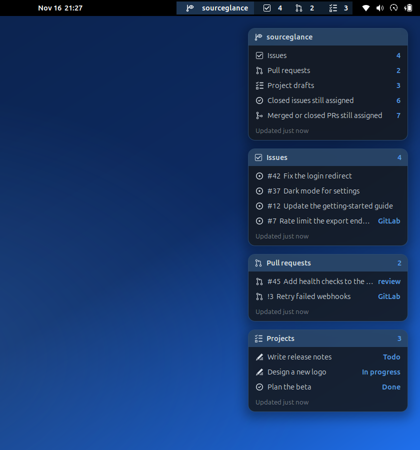
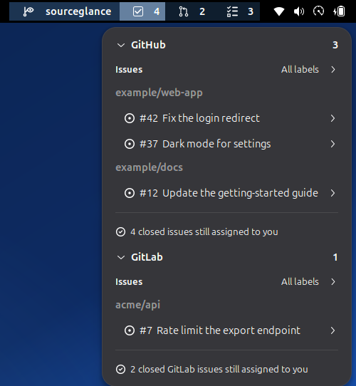
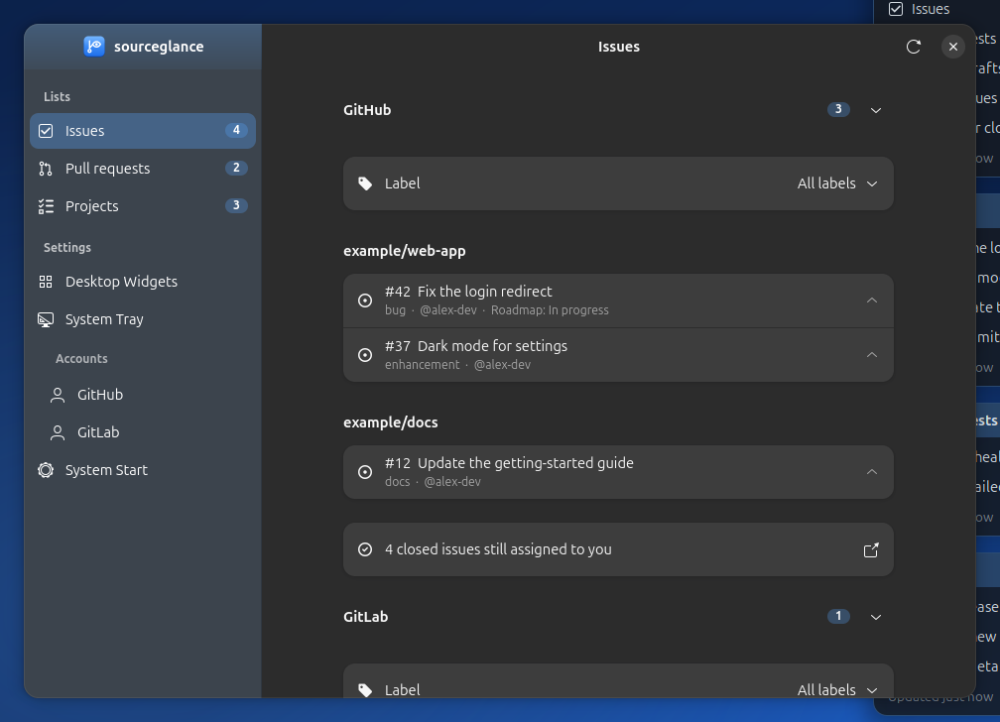

# sourceglance

**Your GitHub and GitLab issues, pull requests and project boards, one glance away: in the
Ubuntu top bar, in their own window, and right on your desktop.**

[](LICENSE)
[](https://github.com/omer-gh/sourceglance/actions/workflows/lint.yml)
[](src/metadata.json)
[](https://github.com/omer-gh/sourceglance/releases)

**Home page and download: <https://omer-gh.github.io/sourceglance/>** ·
Made by **Mohammad Omer** ([@omer-gh](https://github.com/omer-gh))

Source Glance is a GNOME Shell extension for Ubuntu Desktop. It shows what's assigned to you
on GitHub and gitlab.com, and lets you act on it, without opening a browser:

- **Top-bar buttons** for Issues, Pull requests and Projects, each with a live count.
- **Desktop widgets**: cards with your lists, pinned to the desktop under your windows.
- **A main window** with every list, a search box, and all settings in one place.
- **One-click updates**: a verified download, applied without logging out.



> **Status: early releases.** v0.4.2 is the latest, published as a pre-release. Try it, and
> [report anything odd](https://github.com/omer-gh/sourceglance/issues).

## Features

- **Desktop widgets**: Summary, Issues, Pull requests and Projects cards on your desktop.
  Drag them anywhere, set their opacity, click an item to open it.
- **Top bar**: buttons for Source Glance, Issues, Pull requests and Projects as one tinted
  group or as tabs in one menu, each with its count (0 included).
- **Act from anywhere**: comment, close or reopen, edit assignees and labels, and move
  items between statuses on your project boards, from the menus or the window.
- **GitHub and GitLab**: gitlab.com issues and merge requests get their own collapsible
  section in every list, menu and widget; counts add up across both.
- **Projects**: draft items on your GitHub Projects (v2) boards, grouped by status.
- **Search** from the window's title bar: one box filters Issues, Pull requests and Projects
  by title, repository, number, label, person or board status, with match counts. Clear it
  to see everything again.
- **Filter by label**, and see how many closed or merged items are still assigned to you.
- **Main window** with a sidebar for your lists and settings (Desktop Widgets, System Tray,
  Accounts, System Start, About), a splash screen, and an app grid icon, all in the top
  bar's blue.
- **Public repositories** you don't own show up without any setup; private ones appear once
  their owner installs the Source Glance app.
- **Limited access**: signs in through a GitHub App that can only see issues, pull requests
  and projects (no code). Tokens stay in the GNOME keyring.
- **Start automatically** at login, or **Quit** and start it again from the app grid.
- **One-file installer**: a setup wizard that installs, updates, repairs and removes
  Source Glance.
- **Update available** in the window when a new version is out: one click downloads the new
  Setup, checks its SHA-256 checksum, and updates Source Glance without logging out.
- **About** page with the version, the author, and links to report an issue or contribute.

Planned: desktop notifications for new assignments.

## Desktop widgets

Widgets put your lists on the desktop itself, so a glance at the desktop shows what's
waiting for you. They sit below your windows and above desktop icons, so they never cover
your work and stay clickable.

| Card | Shows |
| --- | --- |
| **Summary** | Open issues, pull requests and project drafts, plus closed and merged items still assigned to you |
| **Issues** | Open issues assigned to you, from GitHub and GitLab |
| **Pull requests** | Pull and merge requests assigned to you or awaiting your review |
| **Projects** | Draft items on your project boards, with their status |

- **Turn cards on or off** in Source Glance → **Settings → Desktop Widgets**. Summary is on
  by default.
- **Move a card** by dragging its header; Source Glance remembers where you put it.
  **Reset positions** puts them all back in a column on the right.
- **Opacity** sets how see-through the cards are.
- **Click an item** to open it in your browser. Each card shows when it was last updated
  and refreshes with the rest of Source Glance.

## Requirements

- Ubuntu 24.04 LTS or newer (or any distro with GNOME Shell 46–50)
- A GitHub or gitlab.com account

## Installation

### Setup wizard (recommended)

1. Download **Source Glance Setup** from the
   [home page](https://omer-gh.github.io/sourceglance/) or
   [Releases](https://github.com/omer-gh/sourceglance/releases): one `.AppImage` file
   (`x86_64` for most PCs, `aarch64` for ARM).
2. In Files, right-click it, choose **Properties** and turn on **Executable as Program**.
3. Double-click it and follow the wizard, then log out and back in.

No admin password, app store or apt/snap repository needed. The same Setup file installs,
updates, repairs and removes Source Glance. The [install guide](docs/installing.md) also
covers checking the download.

### Updating

When a newer version is out, a notification says so when you log in, with short release
notes; **Install** there opens the window and starts the update. The window also shows
**Update available** next to Refresh. Click it: Source Glance downloads the new Setup for your PC into a private temporary
folder, checks it against the release's `SHA256SUMS`, and opens it only if it matches. Setup
updates Source Glance in place and starts the new version straight away, with no log-out;
then the window reopens on the new version. You can also just download and run the latest
Setup yourself. Coming from v0.2.0 or earlier, log out once after this first update.

Turn the check off in **Settings → System Start → Check for updates**. It only asks GitHub
for the list of Source Glance releases; nothing about you is sent.

### From source

```bash
git clone https://github.com/omer-gh/sourceglance.git
cd sourceglance
make install
```

Then log out and back in (on Wayland), and enable the extension:

```bash
gnome-extensions enable sourceglance@omer-gh.github.io
```

### Preview without installing for good

```bash
git clone https://github.com/omer-gh/sourceglance.git
```

```bash
cd sourceglance && ./tools/preview.sh
```

The script explains the risks, asks you to accept the [MIT License](LICENSE) (the software
comes with no warranty), and does any one-time setup. See
[docs/development.md](docs/development.md#preview-script-recommended).

### From extensions.gnome.org

Coming with the first stable release.

## Getting started

Open Source Glance from the app grid (or the Source Glance button in the top bar →
**Settings**), then go to **Accounts**:

1. Under **Add an account**, click **GitHub** and choose **Sign in with GitHub**. Source Glance
   copies a short code and opens GitHub; paste it and approve. This gives access to issues,
   pull requests and project boards only: no code, settings or admin access.
2. **Choose repositories** to pick which repositories Source Glance may see. Optionally list
   repositories to watch (`owner/name, owner/other`); leave it empty to see everything
   assigned to you.
3. Optionally, click **GitLab** and approve on gitlab.com the same way. GitLab sign-ins renew
   themselves in the background.

You can add several accounts of each, for example a personal and a work account. Each one
gets its own section in the lists, and changes run as the account the item came from. Every
platform also takes a **personal access token**; each sign-in option says which repositories
it reaches.

**Self-hosted:** **Connect a self-hosted instance** adds GitLab self-managed or GitHub
Enterprise Server. Enter its address; Source Glance checks that it really is that platform,
then you sign in in the browser (with an app you register on the instance) or with a
personal access token. Use `https://`; plain `http://` only works for an instance on your
local network, checked each time Source Glance connects.

**Repositories owned by someone else:**

| Repository | Shows in Source Glance | Comment, close, labels, assignees, status |
| --- | --- | --- |
| Yours, with the app installed | Yes | Yes |
| **Public**, owned by someone else | Yes, without any setup | Only once the owner installs the app; until then, make changes on GitHub |
| **Private**, owned by someone else | Once the owner installs the app | Once the owner installs the app |

To install the app on a repository, its owner opens
<https://github.com/apps/sourceglance/installations/new> and picks the repository.
Organization repositories need an organization owner to install it.

## Using sourceglance

### Top bar



The top bar shows Source Glance's buttons as one tinted block, each list with its count:

- **Source Glance**: who you're signed in as, Refresh, Settings and **About Source Glance**,
  plus **Start automatically** and **Quit**. After Quit, start it again from the app grid icon.
- **Issues**: open issues assigned to you
- **Pull requests**: pull and merge requests assigned to you or awaiting your review
- **Projects**: draft items on your project boards, grouped by status

Each list can be filtered by label and ends with how many closed items are still assigned
to you. In **Settings → System Tray** you choose which lists to show, and whether they're
separate buttons or **tabs in one menu**.

### Actions

Click any issue, pull request or merge request, in a menu or in the window, for its actions:

- **Open on GitHub** / **Open on GitLab**
- **Comment…**
- **Close…** (you confirm first; GitHub issues close as completed or not planned) and
  **Reopen**
- **Assignees…** and **Labels…**
- **Board: Status…** for each project board it's on

### Main window



The window has your **Issues**, **Pull requests** and **Projects** in a sidebar, with counts
and the same actions as the menus, and the settings pages: **Desktop Widgets**, **System
Tray**, **Accounts** (all your GitHub and GitLab accounts, including self-hosted ones) and **System Start** (start at login,
app grid icon). **About** shows the version and the author, with links to report an issue or
fork the repository and contribute.

**Search** the lists from the box on the right of the title bar, always there on every page
(or just start typing; Ctrl+F also jumps there). Searching from a settings page opens the
first list. It matches titles, repositories, `#numbers`, labels, people and board
statuses, across Issues, Pull requests and Projects at once. While you search, the sidebar
counts and the title bar show how many items match. Clear the box, press Esc or click
**Clear search** to see your full lists and counts again; the list you're on stays selected.

## Roadmap

| Milestone | Goal |
| --- | --- |
| `v0.1.0` ✅ | Top bar, main window, desktop widgets, GitHub and gitlab.com, setup wizard |
| `v0.2.0` ✅ | About page: version, author, report an issue, fork and contribute |
| `v0.3.0` ✅ | Update button with verified downloads, updates without logging out, search, one Accounts page |
| `v0.4.0` ✅ | Search box always on the right of the title bar |
| `v0.5.0` | Desktop notifications for new assignments |
| `v1.0.0` | Published on extensions.gnome.org |

Details: [docs/product/roadmap.md](docs/product/roadmap.md).

## Contributing

Source Glance is open source, and your help makes it better.

- **Report an issue:** found a bug, have an idea or a question?
  [Open an issue](https://github.com/omer-gh/sourceglance/issues/new/choose). Include your
  Ubuntu and GNOME Shell versions, and what you expected to happen.
- **Contribute code or docs** by forking the repository:
  1. [Fork Source Glance](https://github.com/omer-gh/sourceglance/fork) to your account and
     clone your fork.
  2. Create a branch, make your change, and run `make lint` and `make test`.
  3. Push the branch to your fork and open a pull request against `main`.

  Start with [CONTRIBUTING.md](CONTRIBUTING.md), and look for issues labelled
  [`good first issue`](https://github.com/omer-gh/sourceglance/labels/good%20first%20issue).

- Developer setup: [docs/development.md](docs/development.md)
- Release process: [RELEASING.md](RELEASING.md)
- Security reports: [SECURITY.md](SECURITY.md) (please don't open public issues for these)

Everyone taking part must follow the [Code of Conduct](CODE_OF_CONDUCT.md).

## Author

**Mohammad Omer**: [@omer-gh](https://github.com/omer-gh) on GitHub.

## License

[MIT](LICENSE) © 2026 Mohammad Omer

Source Glance is not affiliated with or endorsed by GitHub, Inc. or GitLab Inc.
