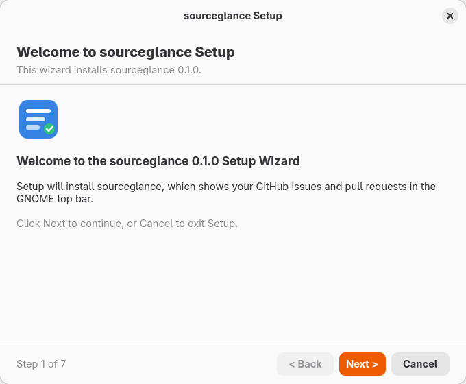
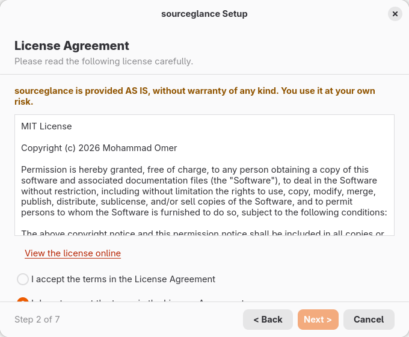
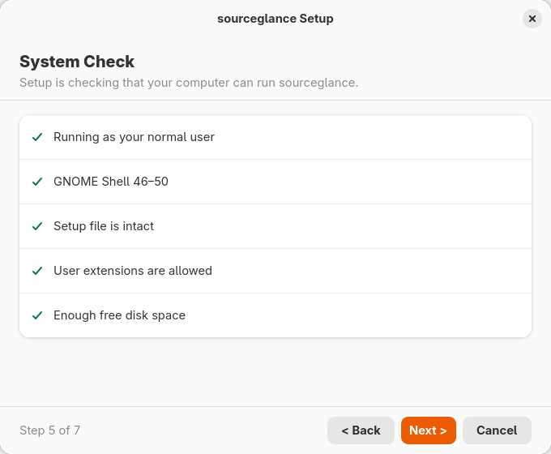
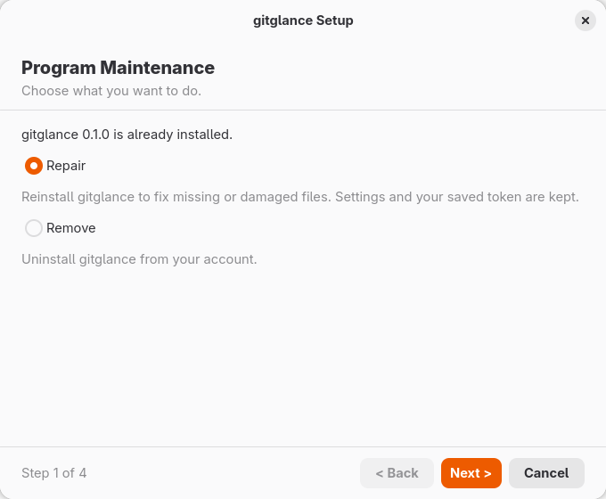

# Installing sourceglance with Setup

sourceglance Setup is a wizard, like a Windows installer: download one file, double-click it,
and follow the steps. No app store, apt/snap repository, terminal or administrator password
is needed.

**Requirements:** Ubuntu 24.04 or newer (or any Linux desktop with GNOME Shell 46–50).

## 1. Download

From the [latest release](https://github.com/omer-gh/sourceglance/releases/latest), download:

- `sourceglance-Setup-X.Y.Z-x86_64.AppImage` for most PCs (Intel or AMD), or
- `sourceglance-Setup-X.Y.Z-aarch64.AppImage` for ARM PCs.

## 2. Verify (recommended)

Only run setup files that come from this repository's Releases page. To check the file
wasn't damaged or changed, download `SHA256SUMS` too and run, in your Downloads folder:

```bash
sha256sum --check --ignore-missing SHA256SUMS
```

It should print `OK`. If you use the GitHub CLI, you can also confirm the file was built by
this repository's release workflow:

```bash
gh attestation verify sourceglance-Setup-0.1.0-x86_64.AppImage --repo omer-gh/sourceglance
```

## 3. Allow it to run (once)

Like Windows SmartScreen's "Run anyway", Linux doesn't run downloaded programs until you
allow it:

1. Open **Files** and go to **Downloads**.
2. Right-click the setup file and choose **Properties**.
3. Turn on **Executable as Program**.

## 4. Double-click and follow the wizard



1. **Welcome** — click **Next**.
2. **License Agreement** — read the MIT License. sourceglance is provided *as is*, without
   warranty. Choose **I accept** to continue.

   

3. **Before You Install** — what Setup will change, and the risks.
4. **Setup Options** — sourceglance installs only for you; leave **Turn on sourceglance after
   installation** on.
5. **System Check** — every line needs a ✓. If **User extensions are turned off**, click
   **Turn On**.

   

6. **Ready to Install** — click **Install**.
7. **Completed** — tick **Log out now** if you like, then **Finish**.

After you log back in, click the sourceglance icon in the top bar and choose **Settings**
(or open **sourceglance** from the app grid). Under **Accounts**:

- **GitHub**: click **Sign in**. sourceglance copies a short code and opens GitHub; paste it
  and approve. Then click **Choose repositories** to pick which repositories it may see.
- **GitLab** (optional): click **Sign in** and approve on gitlab.com the same way.

## Repair, upgrade or remove

Run the same setup file again. If sourceglance is already installed, Setup opens on
**Program Maintenance**:



- **Repair** reinstalls the files. Your settings and saved token are kept.
- **Remove** uninstalls sourceglance. Deleting your saved token and resetting settings are
  separate options, both off by default.
- A newer setup file **upgrades** an older installation automatically. The new version
  starts straight away, with no need to log out (coming from v0.2.0 or earlier, log out
  once after this first update).

sourceglance can do this for you: when a newer version is out, its window shows **Update
available** next to Refresh. Clicking it downloads the new setup file into a private
temporary folder, checks it against the release's `SHA256SUMS`, opens it only if it
matches, and reopens the window on the new version when Setup finishes.

Setup keeps a backup of the previous version in `~/.cache/sourceglance-setup/backups` (the
three most recent), and restores it automatically if an install fails. A log is written
to `~/.cache/sourceglance-setup/setup.log`.

You can also turn sourceglance off or remove it in GNOME's **Extensions** app.

## Command line

The setup file also works from a terminal, for scripts or remote machines:

```bash
./sourceglance-Setup-0.1.0-x86_64.AppImage --help
```

| Command | Effect |
| --------- | -------- |
| `--quiet --accept-license` | Install or upgrade without the wizard. Prints the license; passing `--accept-license` means you accept it, including that there is no warranty. |
| `--quiet --accept-license --repair` | Reinstall |
| `--quiet --uninstall` | Remove (a backup copy is kept) |
| `--check` | Run the system check only |
| `--extract DIR` | Copy the extension files to `DIR` to inspect them; installs nothing |
| `--log FILE` | Write the log to `FILE` |

Exit codes: `0` success, `1` failed, `2` bad usage, `3` cancelled.

## Troubleshooting

| Problem | Fix |
| --------- | ----- |
| Double-clicking does nothing | Make sure **Executable as Program** is on (step 3). |
| "AppImages require FUSE" | Run it from a terminal with `--appimage-extract-and-run`, or install FUSE: `sudo apt install fuse3`. |
| System Check: GNOME Shell not supported | sourceglance needs GNOME Shell 46–50 (Ubuntu 24.04 or newer). |
| System Check: running as administrator | Don't use `sudo`; run Setup as yourself. |
| sourceglance doesn't appear after installing | Log out and back in. GNOME only loads new extensions at login. |
| Something else | [Report a problem](https://github.com/omer-gh/sourceglance/issues/new?template=bug_report.yml) and attach `~/.cache/sourceglance-setup/setup.log` (remove anything private first). |
